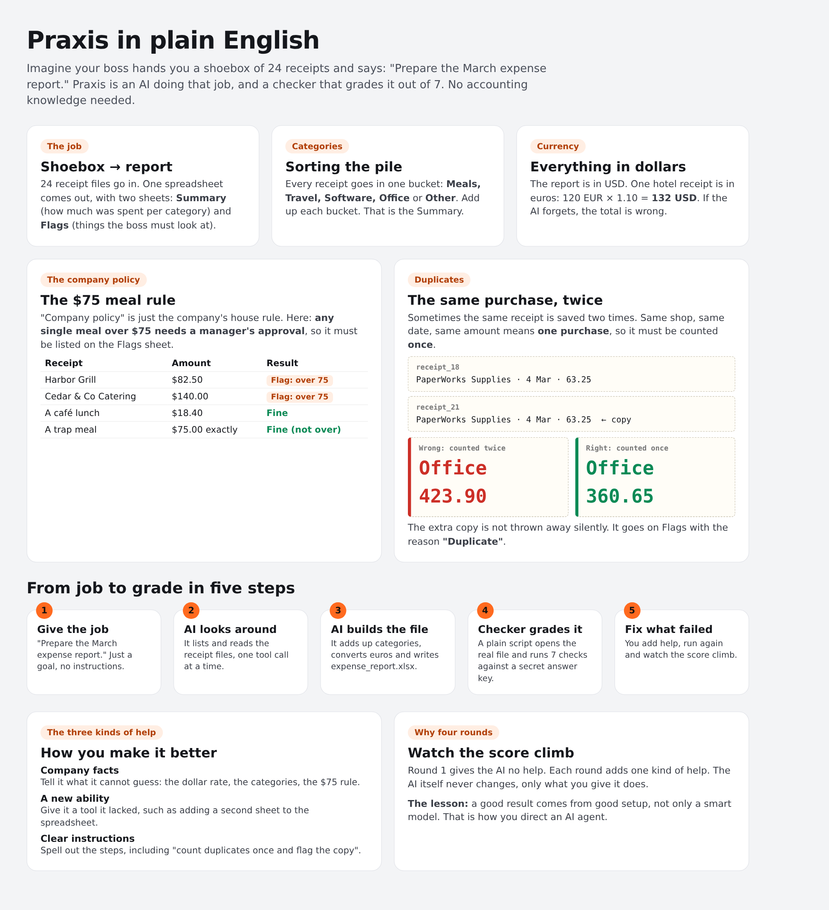
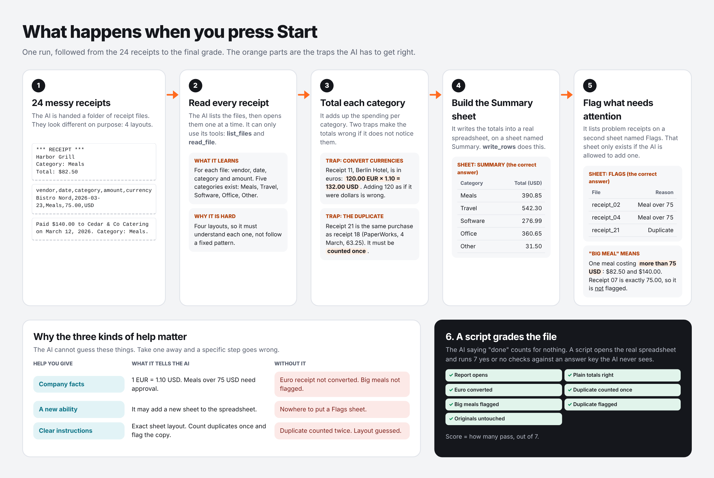
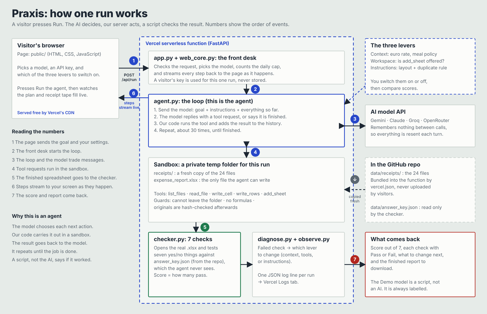

# Praxis

**Give an AI agent a goal. Watch it work. Check the result. Improve it.**

*Praxis* means turning theory into practice. The theory here is the agent framework from Mercor's course; this repo is it, built.

Praxis is a small, hand-written AI agent. You give it one goal, *"Prepare the March expense report"*.
It reads 24 messy receipts in a sandboxed folder, plans its work, uses tools to build a real
`expense_report.xlsx`, and a checker script then opens that file and scores it out of 7.
Then you change one of three things (**context**, **workspace**, **instructions**) and see the score move.

> Built as a capstone applying the framework from Mercor's *Introduction to Agents* course.
> [Verify the certificate](https://work.mercor.com/learn/verify/MRC-2026-BJDT6G82).

**What this project demonstrates:** agentic workflow, single-agent orchestration (a tool-calling loop), agent harness engineering, evaluation, an improvement loop, observability, reliability, model adaptation without fine-tuning, and CI-based delivery. **Left out on purpose:** fine-tuning, multi-agent orchestration (one agent only) and scaling (see [the table below](#production-ai-concepts-what-is-and-is-not-covered)).

**Live demo:** _add your Vercel link here after deploying (see BUILD_GUIDE.md)_

## Why this is an agent, not a chatbot

**The question an interviewer will ask:** "Isn't this just ChatGPT with some documents attached?" It is a fair question, and the honest answer is that the files are not the difference. Modern chat apps accept uploads, and some can run code or call tools, which makes them agent-like too. The difference is **who drives the loop**. In a chat, you do: you ask, read the answer, check it and ask again. In an agent, the model is given a goal and decides each next step itself, across many steps, in a digital workspace, until the job is done.

| | A plain chat (upload documents, get text back) | Praxis (an agent) |
|---|---|---|
| Input | You paste the documents in | You give it a **goal**; the files stay in a workspace it must explore |
| Action | Replies with text (you act on it) | Uses **tools**: list files, open a receipt, write cells, add a sheet |
| Output | A paragraph you copy out | A **real file**, `expense_report.xlsx`, you can download and open |
| Progress | One turn at a time, you steer | A **loop** of up to 30 steps. It can read its own spreadsheet back, spot a gap and carry on |
| Checking | You read it and decide "looks right" | A separate script opens the actual file and tests 7 specific things |
| When it fails | You guess why | The recorded trajectory shows every step, and the diagnosis names the lever to change |

The loop, in one line: **decide the next step, use a tool, see what happened, repeat** until the job is done or the step limit is hit (`praxis/agent.py`). The model has no memory between turns, so every turn resends the goal, the tool list and everything that has happened so far. That is why the three levers (context, tools, instructions) decide the result.

What this does and does not claim: the agent works in a sandboxed folder, with a handful of small tools (list files, read a file, write cells, write rows, and in later rounds add a sheet), on one task. It is a teaching-sized agent. It is not a general computer-use agent.

## Production AI concepts: what is and is not covered

These terms get used loosely, so here is exactly what Praxis does for each one.

| Concept | In plain words | In Praxis | Status |
|---|---|---|---|
| **Agentic workflow** | Goal, plan, use tools, look at the result, repeat | `agent.py` loop with `update_plan` and `finish`, capped at 30 steps | Built |
| **Harness engineering** | Everything around the model that makes it usable: prompt, tools, sandbox, loop control, grader | Prompt builder (`config.py`), file tools, fresh sandbox, a one-time nudge if the model stops using tools, step cap, checker. This is the core of the project | Built |
| **Evaluation** | Measure quality with a test, not a feeling | 7 deterministic checks against a hidden answer key. `compare` runs each setup N times and reports average score, steps, tokens and errored runs | Built, with limits: one task, small N, and real results not run yet |
| **Observability** | See what happened inside a run | Full trajectory of every step (shown on the page and saved). One safe JSON log line per run: score, failed checks, steps, tokens, seconds, stop reason | Basic. No tracing platform, dashboards, alerts or cost tracking |
| **Reliability** | Keeps working when things go wrong | Retries with backoff on rate limits and server errors, tool errors returned to the model so it can recover, step cap, fresh sandbox every run, friendly errors, replay fallback when the daily cap is used up | Partly. No automatic provider failover, and stability is only measured through `compare` |
| **Improvement loop** | Read the failure, change the setup, run again | `diagnose.py` maps failed checks to the lever to change next; the page's coach card walks the four rounds | Built, but human-driven. Nothing improves itself automatically |
| **Model adaptation** | Making a general model fit your task | Done without touching the model: context, tools and instructions (the three levers) | Built at the prompt, context and tool level |
| **Agent orchestration (single agent)** | Coordinating the model, its tools, its plan and when to stop, so one agent can finish a multi-step job | `agent.py` runs the loop: model call, tool call, result back to the model, plan updates, finish or step limit. `web_core.py` streams each step to the page | Built |
| **Fine-tuning** | Training the model's weights | Not used, and not needed for this task. Saved trajectories are the kind of data that could feed fine-tuning later | Not covered |
| **Multi-agent orchestration** | Several agents with different roles handing work to each other | One agent only | Not covered. A possible next step: planner, worker and reviewer agents |
| **Delivery** | Shipping it reliably | GitHub Actions runs the 119 tests on every push and builds and smoke-tests the Docker image (`Dockerfile`, non-root user, health check). Vercel config, and keys in environment variables | Partly. The Vercel deploy has not been run yet, and evals do not gate pushes |
| **Scalability** | Handling many users | Vercel serverless scales by default, but the daily cap is a per-instance temp-file counter, with no queue or shared store | Not covered. Demo-sized by design |
| **Safety and guardrails** | Limit what the agent can do | Sandbox, answer key kept out of reach, no uploads or free-text goals on the public demo, keys never stored or logged | Built |

In short: Praxis is strongest on **harness engineering, evaluation and the improvement loop**, which are the heart of the course. Observability and reliability are real but basic. Multi-agent systems, fine-tuning and scaling are deliberately out of scope for a small teaching project.

### The four terms people ask about most, in more detail

**Reliability.** Making the system behave sensibly when things go wrong, and with language models something always does: rate limits, slow replies, a model that stops using its tools, a tool that errors. *In Praxis:* automatic retries with waiting on rate limits and server errors; tool errors are returned to the model as text so it can try again instead of the run crashing; one nudge if a model answers in plain text instead of calling a tool; a hard 30-step cap so a confused run cannot loop forever; a fresh sandbox every run so one bad run cannot affect the next; plain-English error messages; and a replay fallback when the daily cap is used up. *Not built:* automatic switching to another provider, circuit breakers, alerting.

**Delivery.** Getting working software to users repeatedly and safely: tests, automation, hosting and secrets. *In Praxis:* 119 automated tests, a GitHub Actions workflow that runs them on every push and builds and smoke-tests the container image, a Dockerfile (non-root user, health check, no keys inside), a FastAPI service configured for Vercel (`vercel.json`), API keys only in environment variables, and a no-install dev server for quick previews. *Not yet:* the first live deploy, a first confirmed Docker build (CI does it on the next push), and an "evaluation gate" that blocks a push if agent scores drop.

**Fine-tuning.** Training a model's weights on examples so it behaves differently. It is the heavy way to adapt a model. Praxis adapts the model the light way, with no training: it changes what the model is told (context), what it can do (tools) and how it is instructed. That is usually the first thing to try because it is cheap, instant and reversible. Fine-tuning pays off when prompting is not enough and you have many good examples. *In Praxis:* none, on purpose. The saved trajectories (every step of every run, with a score) are the kind of data that could later be filtered into training examples.

**Orchestration.** Coordinating the moving parts. In a single-agent system the harness orchestrates the model calls, tool calls, plan updates and stop conditions, which is exactly what `agent.py` does. *Multi-agent* orchestration is different: several agents with roles (planner, worker, reviewer) hand work to each other. *In Praxis:* single-agent orchestration only. A natural next step is a reviewer agent that reads the finished spreadsheet and sends it back with comments before the checker grades it.

## Why the agent loop is hand-written

Agent frameworks (LangChain, the OpenAI Agents SDK and others) run the "ask the model, run its tool, repeat" loop for you. Praxis does not use one: the loop is plain Python in `praxis/agent.py`, so every step is visible and explainable (DECISIONS D2).

- **A tool** is a small function my code offers the model (`list_files`, `read_file`, `write_cell`, `write_rows`, `add_sheet`). The model cannot touch a file itself. It sends a request, my code checks and does it, and the result goes back as text. That is also the safety boundary.
- **A tool failure** (for example, reading a file that does not exist) does not crash the run. The error text goes back to the model, which can try something else.
- **The step limit** is 30 model turns. If the agent has not finished by then, the run stops and is scored as it stands. Every run records why it stopped.
- **What it costs:** no built-in tracing or ready-made tools, so retries and the run log are written here. Only three packages are needed.

## The three levers

The model remembers nothing between calls. Everything it knows is what we send it each turn. So output quality comes from three things we control:

1. **Context**: facts the agent needs (the euro rate, the categories, the meal policy).
2. **Workspace**: which tools it is allowed to use (can it add a Flags sheet?).
3. **Instructions**: how clearly the job and the output layout are described (and what to do with duplicates).

The receipts hide traps: a receipt in euros, a duplicate receipt, a meal over the limit, and a meal exactly at the limit (which is *not* over).
Each trap is fixed by one lever, so the four setups tell a clear story:

| Setup | What the agent gets |
|---|---|
| 1. Goal only | just the goal |
| 2. + context | adds rate, categories, policy |
| 3. + context + tool | adds the `add_sheet` tool |
| 4. + context + tool + instructions | adds a clear layout and the duplicate rule |

## The 7 checks

1. The report opens and has a Summary sheet
2. Meals, Software and Other totals are correct
3. The euro receipt was converted to USD (Travel total)
4. The duplicate receipt was counted once (Office total)
5. Meals over the policy limit are on the Flags sheet
6. The duplicate receipt is on the Flags sheet
7. The original receipts were not changed

## How it works

One run, followed from the 24 receipts to the final grade:

New to this? Watch the 2-minute explainer: [public/praxis-explainer.mp4](public/praxis-explainer.mp4). The same story as a picture:





How the pieces fit together in the code:



```
 goal ─▶ agent loop ──▶ model (Gemini / Groq / OpenRouter / Claude)
            │  ▲               │ asks for a tool
            │  └── result ◀── sandboxed tools (list_files, read_file, write_cell, write_rows, add_sheet)
            ▼
   expense_report.xlsx ─▶ checker (7 checks) ─▶ diagnosis ("change this lever") ─▶ saved log
```

- `praxis/agent.py`: the loop, about 100 lines, no framework.
- `praxis/llm.py`: one small interface, one adapter per provider. Switch provider with one setting.
- `praxis/tools.py`: the sandbox. Fresh copy of the receipts every run, no path escapes, writes only to the report, originals hash-verified.
- `praxis/checker.py`: deterministic checks against an answer key the agent can never see.
- `praxis/diagnose.py`: failed check or tool error → which lever to change.
- `praxis/web_core.py` + `app.py`: the web API (FastAPI) streams each step to the page as it happens. `public/` is the page itself: plain HTML, CSS and JavaScript, no build step.

## Technologies


The core is plain **Python** and its **standard library**. Only three third-party packages are needed: `openpyxl` (real Excel files), `requests` (calls the AI providers' web APIs) and `fastapi` (the web framework). The page is plain HTML, CSS and JavaScript, hosted on Vercel and tested with GitHub Actions. [docs/TECH_STACK.md](docs/TECH_STACK.md) lists every module and package, what each is for, and where it comes from, and explains why FastAPI was chosen.

## Code flow

A click on **Start round** becomes `POST /api/run`, which validates the request, builds a fresh sandbox, runs the agent loop, grades the real file, and streams every step back to the page. The full walkthrough with diagrams is in [docs/FLOW.md](docs/FLOW.md). The reasons behind each choice are in [DECISIONS.md](DECISIONS.md).

## Run it

```bash
pip install -r requirements.txt
cp .env.example .env            # add a free Gemini key (see BUILD_GUIDE.md)

python -m praxis run --provider demo --setup baseline      # no key needed (scripted, NOT an AI)
python -m praxis run --provider gemini --setup instructions
python -m praxis compare --provider gemini --runs 5
uvicorn app:app --reload            # the web app (needs requirements.txt)
python scripts/dev_server.py        # the same page with no installs
python -m unittest discover -s tests -v
```

### Run it in Docker

Docker packages the app, its Python version and its packages into one image, so it runs the same on any machine.

```bash
cp .env.example .env                        # add your key; it is read at run time and never baked into the image
docker build -t praxis .                    # build the image from the Dockerfile
docker run --rm -p 8000:8000 --env-file .env praxis    # start a container, then open http://localhost:8000
# or, with Docker Compose:
docker compose up --build
```

The image runs as a non-root user, has a health check on `/api/health`, and leaves out `.env` (see `.dockerignore`). CI builds the image and smoke-tests it on every push (`.github/workflows/ci.yml`, job `docker`).

## Results

> **Not measured yet.** The table below is intentionally empty. Fill it only from real runs with
> `python -m praxis compare --provider <name> --runs 5`, and state the model that produced it.

| Model | 1. Goal only | 2. + context | 3. + tool | 4. + instructions |
|---|---|---|---|---|
| _(model name)_ | – | – | – | – |

The `logs/example_demo_*` files and `results/example_demo_compare.json` come from a **scripted demo model, not an AI**. They exist so the app has something to replay without a key. They are not results.

## Observability

- **Inside one run:** the receipt tape is the trajectory: every tool call, its arguments, the result, whether it worked and how long it took. Failed checks come with a diagnosis of which lever to change.
- **Across runs:** the server writes one JSON line per run (`praxis/observe.py`). On Vercel it appears in the project's Logs tab. Example:
  `{"event": "run", "provider": "gemini", "setup": "Goal only", "score": 3, "total": 7, "failed_checks": ["euro", "dup_total"], "tool_calls": 26, "tool_errors": 0, "tokens_in": 41200, "tokens_out": 1900, "seconds": 38.2, "stop_reason": "finished", ...}`
- **Never logged:** API keys, receipt text, what the agent wrote, or a visitor's edited instructions. Errors are shortened and keys are redacted. Tests check this.
- **Not included:** a dashboard or a tracing platform. The log lines are structured so one could be added later.

## Safety on the public demo

Only the built-in receipts are used (no uploads, no free-text goal). Runs on the host's key are capped per day (best effort on a serverless host), the app falls back to replaying saved runs, and visitors can paste their own key, which is used for that session only and never stored.

## Honest limits

- 24 receipts and one task: this teaches the method, it is not a benchmark.
- Free-tier models are weaker and rate limited; scores vary between runs, which is why `compare` averages several.
- The checker tests the output file, not whether the agent's reasoning was good.
