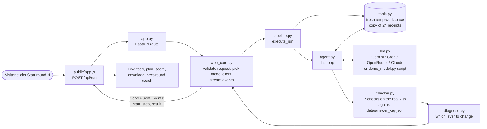

# Code flow

How one run travels through Praxis, from a button click to a graded spreadsheet.
File names are in `praxis/` unless stated.

## 1. The whole thing in one picture

The diagram below shows the flow. For the version that also shows every technology, and where each one comes from, see the big picture:


And the same flow as a simple chart:



## 2. The agent loop (`agent.py`)

```mermaid
sequenceDiagram
    participant Loop as run_agent()
    participant Model as LLM (via llm.py)
    participant Tools as Workspace (tools.py)
    Loop->>Model: system prompt + goal + tool list
    loop up to 30 turns
        Model-->>Loop: text and/or tool calls
        alt tool call
            Loop->>Tools: list_files / read_file / write_cell / write_rows / add_sheet
            Tools-->>Loop: observation (or ERROR text)
            Loop->>Model: the result, plus everything so far
        else update_plan
            Loop-->>Loop: record the plan step
        else finish
            Loop-->>Loop: stop, keep the summary
        end
    end
```

Why everything is resent each turn: the model has **no memory** between calls. The loop keeps the message
list and sends all of it every time. That is also why the three levers decide the result: they change what is in
that list (company facts and instructions go into the system prompt) or what the model is allowed to do (the tool list).

If a model replies in plain text with no tool call, it is nudged once to keep using tools. A tool error is
returned to the model as text instead of stopping the run, so it can recover.

## 3. Step by step

1. **Click.** `public/app.js` sends `POST /api/run` with the three lever flags, the provider and an optional visitor key.
2. **Validate.** `web_core.parse_run_request` checks the payload. `pick_client` builds the model client:
   the demo script, the host's key (with a daily cap in `caps.py`), or the visitor's key (used once, never stored).
3. **Sandbox.** `pipeline.execute_run` calls `Workspace.create()`: a new temp folder with a copy of the 24 receipts.
   Tools can only touch that folder. The answer key is never copied in.
4. **Build the prompt.** `config.build_config` turns the three flags into the system prompt text and the allowed tools.
   `add_sheet` exists only when the "new ability" lever is on.
5. **Loop.** `agent.run_agent` runs the loop above. Each step is emitted as an event.
6. **Stream.** `web_core.stream_run` runs the agent in a worker thread and yields each step to the browser as a
   Server-Sent Event (`start`, `step`, `result`, `error`), with keep-alives during slow model calls.
7. **Grade.** `checker.check_workspace` opens the real `expense_report.xlsx` and runs 7 checks:
   `report`, `plain`, `euro`, `dup_total`, `policy`, `dup_flag`, `untouched` (hash of the original receipts).
8. **Diagnose.** `diagnose.diagnose` turns failed checks and tool errors into "which lever to change next".
9. **Log.** `observe.log_run` writes one numbers-only JSON line per run. It never logs keys, receipt text or agent output.
10. **Show.** The page draws the score, the 7 checks, the hints and the coach card, and offers the spreadsheet as a download.

## 4. Other entry points

| Command | What it does |
|---|---|
| `python -m praxis run --provider demo --setup baseline` | one run in the terminal |
| `python -m praxis compare --provider gemini --runs 5` | all four setups, N times each, saved as a results table |
| `python -m praxis make-data` | regenerate the receipts and the private answer key |
| `python -m praxis make-examples` | save scripted example runs used by "Play the saved run" |
| `uvicorn app:app --reload` | the web app (FastAPI) |
| `python scripts/dev_server.py` | the same routes with the standard library only, no installs |

## 5. Where the production-AI concepts show up in the flow

Each term below is a word you will hear in AI jobs. Here is what it means in plain English, and the exact place in the flow where Praxis does it.

| Concept | What it means in plain English | Where it happens in the flow |
|---|---|---|
| Agentic workflow | The AI is given a goal and works toward it by itself, one step at a time, instead of answering once | **Step 5.** The loop in `agent.py`: decide the next step, use a tool, look at what happened, repeat |
| Agent orchestration | The code that coordinates the model, its tools, its plan and when to stop, so one agent can finish a job with many steps | **Steps 5 and 6.** `agent.py` runs the loop, and `web_core.py` streams each step to the page as it happens |
| Harness engineering | The "harness" is everything wrapped around the model that makes it usable and safe: its instructions, its tools, its workspace, and the rules for when to stop | **Steps 3 to 5.** The fresh sandbox, the prompt builder, the tool list, the 30-step limit, the one-time nudge, and the error recovery |
| Evaluation | Testing how good the result is with a real test instead of a feeling | **Step 7.** `checker.py` opens the real spreadsheet and runs 7 checks. `compare.py` repeats each setup several times and averages the scores |
| Improvement loop | Reading why it failed, changing one thing, and trying again | **Step 8.** `diagnose.py` says which kind of help to add, and the next round on the page applies it |
| Observability | Being able to see what happened inside a run, afterwards | **Steps 5 and 9.** Every step is recorded as a trajectory, and `observe.py` writes one safe summary line per run |
| Reliability | Not falling over when something goes wrong | Retries in `llm.py` when a service is busy, tool errors sent back to the model so it can recover, the 30-step limit, and a fresh sandbox every run |
| Model adaptation | Making a general-purpose AI fit your specific job | **Step 4.** The three kinds of help change what the AI is told and what it can do. The AI itself is never changed |
| Delivery | Getting the project out to real users in a repeatable, safe way | `.github/workflows/ci.yml` runs the tests on every push and builds and smoke-tests the Docker image, the `Dockerfile` packages the app so it runs the same anywhere, `vercel.json` sets up hosting, and keys live in environment variables, never in the code |

## 6. Where each decision is recorded

See `DECISIONS.md` (D1 to D27). The short current summary used by the coding assistant is `CLAUDE.md`.
