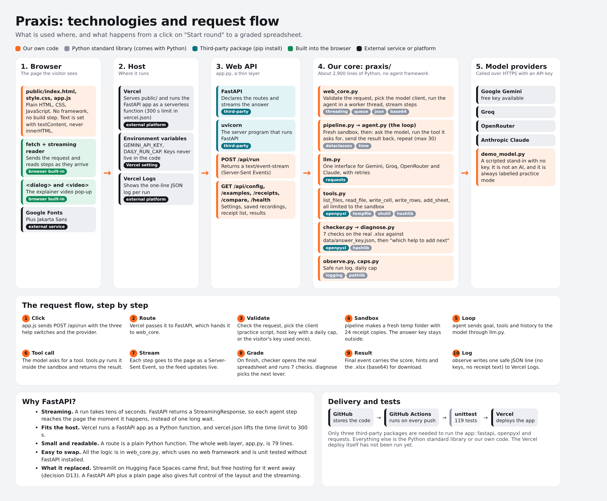

# Technologies used, and where each one comes from

A cheat sheet for explaining the stack in an interview. The idea: for every item, know **what it is**, **where it comes from** and **why it is here**.

The picture above shows what is used where and how a request travels. Colour tells you where each item comes from: orange is our own code, grey is the Python standard library, teal is a third-party package, green is built into the browser, black is an external service.

## Why FastAPI?

- **Streaming.** A run takes tens of seconds. FastAPI returns a `StreamingResponse`, so each agent step reaches the page the moment it happens instead of after one long wait.
- **Fits the host.** Vercel runs a FastAPI app as a Python function, and `vercel.json` lifts the time limit to 300 seconds. (The deploy itself has not been run yet.)
- **Small and readable.** A route is a plain Python function. The whole web layer, `app.py`, is 79 lines.
- **Easy to swap.** All the logic is in `praxis/web_core.py`, which uses no web framework and is unit tested without FastAPI installed. FastAPI is only the thin wiring.
- **What it replaced.** Streamlit on Hugging Face Spaces came first, but free hosting for it went away (DECISIONS D13). A FastAPI API plus a plain page also gives full control of the layout and the streaming.
- **Honest note.** The automatic docs page is switched off in `app.py`, and the FastAPI wiring itself has not been run end to end yet (see the README status).

## First, the words people mix up

| Word | What it means |
|---|---|
| Module | A single `.py` file you can `import`. |
| Package | A folder of modules. `praxis/` is our own package. `openpyxl` and `requests` are packages other people wrote. |
| Library | Reusable code that you call when you need it. You are in charge. Most modules and packages are libraries. |
| Framework | Code that calls yours. FastAPI is one: you write small route functions and it decides when to run them. |
| Standard library | The modules that come with Python itself. Nothing to install. |
| Third-party package | Code written by others, published on PyPI (the Python package index), installed with `pip`. |
| Service or API | Someone else's program running on their servers that you call over the internet. |

## 1. Languages and standards

- **Python 3** is the main language. It is made by the Python Software Foundation, and its standard library comes with it.
- **HTML, CSS and JavaScript** are the languages of the page. They are built into every browser.
- **HTTP and JSON** are how the page, the API and the AI providers talk. **Server-Sent Events** is a web standard for a server to stream updates to a page. **.xlsx** is the Excel file format that `openpyxl` reads and writes.

## 2. Python standard library (comes with Python, nothing to install)

| Module | What we use it for |
|---|---|
| `argparse` | Reads terminal commands such as `python -m praxis run` (`cli.py`) |
| `base64` | Encodes the spreadsheet so it can travel inside a streamed message (`web_core.py`) |
| `dataclasses` | Small structured records for config and model replies |
| `datetime` | Timestamps on saved runs |
| `hashlib` | SHA-256 fingerprints of the original receipts, to prove they were not changed (`tools.py`, `checker.py`) |
| `http.server, urllib, mimetypes` | The no-install preview server (`scripts/dev_server.py`) |
| `json` | Reading and writing the answer key, run logs and API messages |
| `logging` | The one-line-per-run log (`observe.py`) |
| `os, sys, pathlib` | Files, folders, environment variables (where keys are read) |
| `queue, threading` | Run the agent in a worker thread and pass its steps to the streaming response (`web_core.py`) |
| `re` | Pattern matching, for example reading amounts out of receipt text |
| `shutil, tempfile` | Make a fresh temporary copy of the receipts for every run (`tools.py`) |
| `time` | Timing steps and runs |
| `typing, __future__` | Type hints and modern syntax; they help readers and tools but do not change behaviour |
| `uuid` | A short random id for each saved run (`runlog.py`) |
| `unittest` | The test framework used by the 119 tests |

## 3. Third-party packages (from PyPI, installed with pip)

| Package | What it is | Who makes it | How you get it | What we use it for |
|---|---|---|---|---|
| openpyxl | Reads and writes real .xlsx Excel files | Open-source, community maintained | `pip install openpyxl` from PyPI | The agent's tools write the report, and the checker reads it back |
| requests | Makes HTTP calls | Open source; maintained under the Python Software Foundation | `pip install requests` from PyPI | Talks to the AI providers' web APIs (`llm.py`) |
| FastAPI | A web framework: you declare routes and it handles the web server plumbing | Open source, created by Sebastian Ramirez | `pip install fastapi` from PyPI | The web API in `app.py` |
| uvicorn | The server program that runs a FastAPI app | Open source, from the Encode project | `pip install uvicorn` from PyPI | `uvicorn app:app --reload` (development) |
| httpx, pytest | Test helpers: httpx for calling the API in tests, pytest as an alternative test runner | Open source | `pip install -r requirements-dev.txt` | Development and CI only, not needed to run the app |

Our dependency list is short on purpose: `requirements.txt` has only `fastapi`, `openpyxl` and `requests`.

## 4. Our own code

The `praxis/` folder is a package we wrote (about 2,900 lines of Python, no agent framework). `app.py` is the thin FastAPI wiring. `public/` is the page.

## 5. External services (called over the internet, not installed)

| Service | What it is | Notes |
|---|---|---|
| Google Gemini, Groq, OpenRouter, Anthropic Claude | AI model providers. We call their web APIs over HTTPS with an API key | Run by those companies. Not installed, only called |
| Vercel | Hosting platform that runs the FastAPI app and serves the page | Company service. Configured by `vercel.json` |
| GitHub and GitHub Actions | Stores the code, and runs the tests on every push (`.github/workflows/ci.yml`) | GitHub service |
| Google Fonts | Serves the Plus Jakarta Sans font to the page | External stylesheet loaded by the browser |

## 6. In the browser (no install)

| Item | What it is | Where it comes from |
|---|---|---|
| HTML, CSS, JavaScript | The three languages every browser understands. No framework and no build step | Built into every browser |
| fetch and streaming reads | How the page calls the API and reads the streamed steps | Browser built-in (a web standard) |
| `<dialog>` and `<video>` | The pop-up and the video player | Browser built-ins, no library |

## 7. Tools used to build, test and record (not part of the shipped app)

| Tool | What it is | Where it comes from | What we used it for |
|---|---|---|---|
| Playwright | Controls a headless Chromium browser | Microsoft, open source (installed with pip) | Tested the page at phone and desktop widths and recorded the video scenes |
| ffmpeg | A command-line program for audio and video | Open source, installed as a program, not a Python package | Joined the scenes, mixed the audio, made the .mp4 and .webm |
| sherpa-onnx and Kokoro | A speech engine, and the open-source voice model it runs | Open-source project (k2-fsa) and an open voice model, downloaded from GitHub releases | Generated the narration locally with no account or key |
| Mermaid | Draws diagrams from text | Rendered by GitHub itself, nothing to install | The diagrams in `docs/FLOW.md` |
| Docker | Packages an app and everything it needs into one image that runs the same on any machine | Docker, Inc. (open-source engine). Needs Docker Desktop or Docker Engine installed | `Dockerfile` and `docker-compose.yml`: run Praxis without installing Python or packages. CI builds the image on every push |

## Docker in one minute

- **Image** is the sealed package: Python 3.12, the three packages and the project files. The `Dockerfile` is the recipe for it.
- **Container** is a running copy of an image. `docker run` starts one.
- **Why it is here:** anyone can run Praxis with one command and no Python setup, the environment is the same on a laptop, in CI and on a server, and it is the route to an always-on host if Vercel's time limits get in the way.
- **What is inside the recipe:** it starts from `python:3.12-slim`, installs the packages before copying the code (so rebuilds are fast), runs as a non-root user, and has a health check on `/api/health`. Keys are never baked in: they are passed in at run time with `--env-file`.
- **Honest note:** CI builds and smoke-tests the image on every push. It has not yet been built on a developer machine.

## How to say it in an interview

> "The core is plain Python and its standard library: `threading` and `queue` for the streaming worker, `hashlib` to prove the original files were not touched, `tempfile` for the per-run sandbox. Only three third-party packages are needed: `openpyxl` for real Excel files, `requests` for the AI providers' web APIs, and FastAPI as the web framework. I wrote the agent loop myself instead of using an agent framework, so I can explain every line. It is hosted on Vercel and tested by GitHub Actions."
